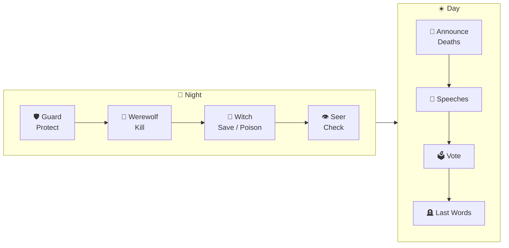

<div align="center">
  
  <h1>🐺 AgentWereWolf</h1>
  <p>AI-powered Werewolf (Mafia) game where every player except you is driven by LLM agents with memory, personality, and strategic reasoning.</p>

  
</div>

<br/>

[中文版 README](./README_CN.md) | [Agent Architecture](./AGENT_ARCHITECTURE.md)

## Features

- **LLM-Driven AI Players** — Each AI has a unique personality, memory system, and trust network. They remember what happened, reflect on their actions, and dynamically adjust their strategies.
- **Memory-Reflection Loop** — Agents read memory before decisions, then reflect and write back after every action (trust scores, emotional state, plans).
- **Multi-Model Support** — Assign different LLM providers/models to different players (DeepSeek, Qwen, Gemini, GPT, Claude, etc.).
- **Multiplayer Rooms** — Create rooms, share links, and play with friends. Spectator mode supported.
- **Full Game Flow** — Night actions (Guard → Werewolf → Witch → Seer), day speeches, voting, last words, hunter shots, sheriff election.
- **Real-Time WebSocket** — Smooth, live game updates with day/night transition animations.
- **Per-Player LLM Config** — Fine-tune model, temperature, and max tokens per seat via JSON config.
- **Decision Logging** — Full logs of every AI decision (prompt, raw response, parsed result) for analysis and debugging.

## Quick Start

### Prerequisites

- Python 3.9+
- An LLM API key (DeepSeek, DashScope, or any OpenAI-compatible endpoint)

### Install

```bash
git clone https://github.com/yourname/AgentWereWolf.git
cd AgentWereWolf
pip install -r requirements.txt
```

### Configure LLM

```bash
cp .env.example .env
# Edit .env with your API key
```

```env
DEEPSEEK_API_KEY=your-api-key
DEEPSEEK_API_BASE=https://api.deepseek.com
DEEPSEEK_MODEL=deepseek-chat
```

Or configure per-player models in `llms_config/example.json`.

### Run

```bash
python main.py
```

Open **http://localhost:8080** and start playing.

## Roles

| Role | Team | Ability |
|------|------|---------|
| 👤 Villager | Village | No special ability. Find wolves through discussion and voting. |
| 🐺 Werewolf | Wolf | Kill one player each night. Coordinate with teammates. |
| 👁️ Seer | Village | Check one player's identity each night. |
| 🧪 Witch | Village | One antidote (save) + one poison (kill), each single-use. |
| 🔫 Hunter | Village | Shoot one player upon death (not when poisoned). |
| 🛡️ Guard | Village | Protect one player each night. Cannot protect the same player consecutively. |

## How It Works

### Game Flow



### AI Agent Architecture

```
Event → Rule Update (keywords, trust ±) → Read Memory → LLM Decision → LLM Reflection → Write Memory
```

Each AI agent maintains:
- **Player Analysis** — Claimed roles, vote history, suspicion/defense relationships
- **Trust Network** — Dynamic trust scores (-1.0 to 1.0) for every player
- **Emotional State** — calm / anxious / suspicious / confident / desperate
- **Strategic Plan** — Short-term goals updated after each reflection
- **Reflection Log** — Structured inner monologue after key actions

For detailed architecture documentation, see [AGENT_ARCHITECTURE.md](./AGENT_ARCHITECTURE.md).

## Project Structure

```
AgentWereWolf/
├── main.py                 # FastAPI server + WebSocket + room management
├── game_controller.py      # Game flow orchestration + agent integration
├── agent/                  # AI Agent system
│   ├── memory.py           # Memory data structures + LLM reflection
│   ├── decision.py         # LLM-powered decision engine
│   ├── information.py      # Role-based info visibility filter
│   └── strategy.py         # Role strategy library (from roles/*.json)
├── game/                   # Game phase logic
│   ├── core/               # State management, phase transitions
│   └── phases/             # Phase implementations (night, vote, speech, etc.)
├── game_types/             # Type definitions (dataclasses)
├── lib/                    # Utilities
│   ├── llm.py              # LLM API client (OpenAI-compatible)
│   ├── game_master.py      # Player setup, win condition, state helpers
│   ├── prompt_utils.py     # Prompt construction utilities
│   ├── game_constants.py   # Config constants
│   └── game_logger.py      # Per-player decision logging (JSONL)
├── llms_config/            # Per-player LLM configurations
├── roles/                  # Role definitions (JSON)
├── static/                 # Web frontend (HTML + CSS + JS)
└── docs/                   # Design documents
```

## Configuration

### Per-Player LLM Config

Edit `llms_config/example.json` to assign different models per seat:

```json
{
  "default": "deepseek-chat",
  "players": {
    "seat_0": "qwen-plus",
    "seat_2": { "config": "deepseek-chat", "temperature": 0.9 }
  }
}
```

Each model has its own JSON config file in `llms_config/` (model name, provider, api_base, api_key, temperature, max_tokens).

### Game Settings

- **Player count**: 8–12
- **Difficulty**: easy / normal / hard (affects AI strategy depth)
- **Roles auto-scale** with player count

## Tech Stack

- **Backend**: Python, FastAPI, WebSocket, asyncio
- **Frontend**: Vanilla HTML + CSS + JavaScript (no framework)
- **AI**: Any OpenAI-compatible LLM API
- **Communication**: Real-time WebSocket with heartbeat

## Roadmap

- [ ] Sheriff election mechanism (上警竞选)
- [ ] New roles: Medium / Mirror Maiden (通灵师/镜子少女), Wolf Beauty & Knight (狼美人与骑士), etc.

## License

MIT
