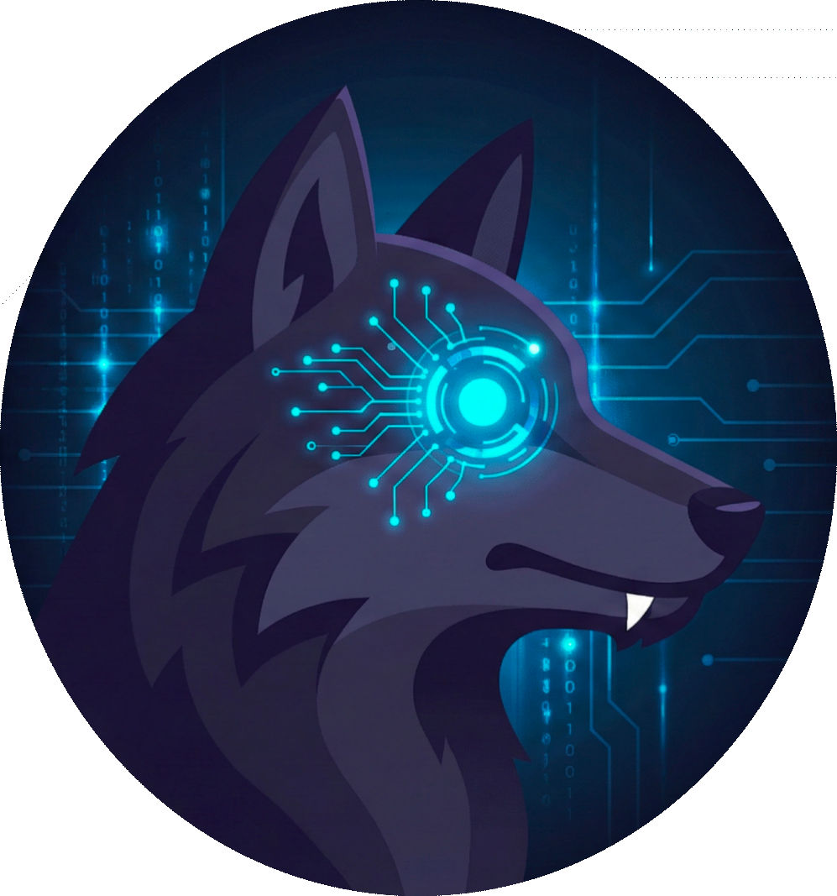
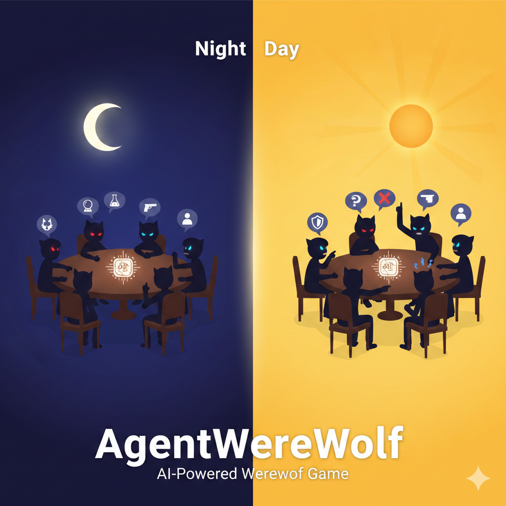
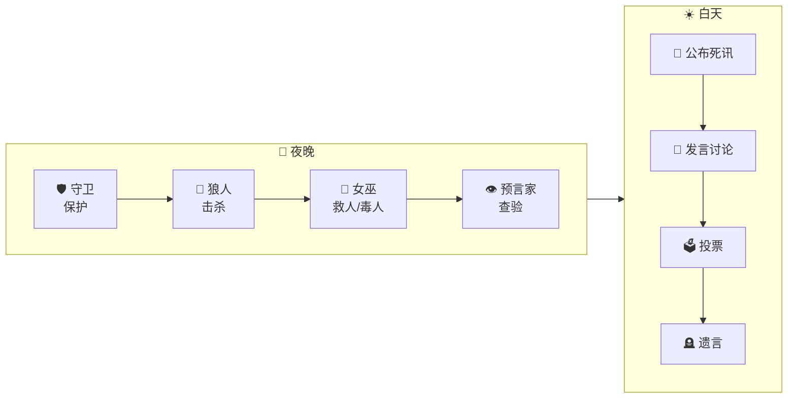

<div align="center">
  
  <h1>🐺 AgentWereWolf — AI 狼人杀</h1>
  <p>每个玩家都由 LLM 驱动的 AI 狼人杀游戏。AI 拥有独立记忆、性格和策略推理能力。</p>

  
</div>

<br/>

[English README](./README.md) | [Agent 架构文档](./AGENT_ARCHITECTURE.md)

## 特性

- **LLM 驱动的 AI 玩家** — 每个 AI 有独特性格、记忆系统和信任网络，会记住发生的事、反思自己的行动、动态调整策略
- **记忆-反思循环** — 行动前读取记忆，行动后反思写回（信任分数、情绪状态、计划）
- **多模型支持** — 可为不同座位分配不同 LLM（DeepSeek、通义千问、Gemini、GPT、Claude 等）
- **多人房间** — 创建房间、分享链接、和朋友一起玩，支持观战模式
- **完整游戏流程** — 夜间行动（守卫→狼人→女巫→预言家）、白天发言、投票、遗言、猎人开枪、警长竞选
- **实时 WebSocket** — 流畅的实时游戏更新，日夜过渡动画
- **逐玩家 LLM 配置** — 通过 JSON 配置为每个座位设置模型、温度、最大 token 数
- **决策日志** — 完整记录每次 AI 决策（prompt、原始响应、解析结果），便于分析调试

## 快速开始

### 环境要求

- Python 3.9+
- LLM API Key（DeepSeek、DashScope 或任何 OpenAI 兼容接口）

### 安装

```bash
git clone https://github.com/yourname/AgentWereWolf.git
cd AgentWereWolf
pip install -r requirements.txt
```

### 配置 LLM

```bash
cp .env.example .env
# 编辑 .env 填入你的 API Key
```

```env
DEEPSEEK_API_KEY=your-api-key
DEEPSEEK_API_BASE=https://api.deepseek.com
DEEPSEEK_MODEL=deepseek-chat
```

也可以在 `llms_config/example.json` 中为每个玩家配置不同模型。

### 启动

```bash
python main.py
```

打开 **http://localhost:8080** 开始游戏。

## 角色

| 角色 | 阵营 | 能力 |
|------|------|------|
| 👤 村民 | 好人 | 无特殊能力，通过讨论和投票找出狼人 |
| 🐺 狼人 | 狼人 | 每晚击杀一名玩家，与队友协作 |
| 👁️ 预言家 | 好人 | 每晚查验一名玩家的身份 |
| 🧪 女巫 | 好人 | 解药（救人）+ 毒药（毒人），各一次 |
| 🔫 猎人 | 好人 | 死亡时可开枪带走一人（被毒死除外） |
| 🛡️ 守卫 | 好人 | 每晚保护一名玩家，不能连续保护同一人 |

## 工作原理

### 游戏流程



### AI Agent 架构

```
事件 → 规则更新（关键词、信任±）→ 读取记忆 → LLM 决策 → LLM 反思 → 写回记忆
```

每个 AI Agent 维护：
- **玩家分析** — 声称角色、投票历史、怀疑/辩护关系
- **信任网络** — 对每个玩家的动态信任分数（-1.0 到 1.0）
- **情绪状态** — 冷静 / 焦虑 / 多疑 / 自信 / 绝望
- **策略计划** — 每次反思后更新的短期目标
- **反思日志** — 关键行动后的结构化内心独白

详细架构文档见 [AGENT_ARCHITECTURE.md](./AGENT_ARCHITECTURE.md)。

## 项目结构

```
AgentWereWolf/
├── main.py                 # FastAPI 服务器 + WebSocket + 房间管理
├── game_controller.py      # 游戏流程控制 + Agent 集成
├── agent/                  # AI Agent 系统
│   ├── memory.py           # 记忆数据结构 + LLM 反思生成
│   ├── decision.py         # LLM 驱动的决策引擎
│   ├── information.py      # 基于角色的信息可见性过滤
│   └── strategy.py         # 角色策略库（读取 roles/*.json）
├── game/                   # 游戏阶段逻辑
│   ├── core/               # 状态管理、阶段转换
│   └── phases/             # 各阶段实现（夜晚、投票、发言等）
├── game_types/             # 类型定义（dataclass）
├── lib/                    # 工具库
│   ├── llm.py              # LLM API 客户端（OpenAI 兼容）
│   ├── game_master.py      # 玩家设置、胜负判定、状态辅助
│   ├── prompt_utils.py     # Prompt 构建工具
│   ├── game_constants.py   # 配置常量
│   └── game_logger.py      # 逐玩家决策日志（JSONL）
├── llms_config/            # 逐玩家 LLM 配置
├── roles/                  # 角色定义（JSON）
├── static/                 # Web 前端（HTML + CSS + JS）
└── docs/                   # 设计文档
```

## 配置

### 逐玩家 LLM 配置

编辑 `llms_config/example.json` 为不同座位分配模型：

```json
{
  "default": "deepseek-chat",
  "players": {
    "seat_0": "qwen-plus",
    "seat_2": { "config": "deepseek-chat", "temperature": 0.9 }
  }
}
```

每个模型在 `llms_config/` 下有独立的 JSON 配置文件（模型名、provider、api_base、api_key、temperature、max_tokens）。

### 游戏设置

- **玩家人数**：8–12 人
- **难度**：简单 / 普通 / 困难（影响 AI 策略深度）
- **角色配置**随人数自动调整

## 技术栈

- **后端**：Python、FastAPI、WebSocket、asyncio
- **前端**：原生 HTML + CSS + JavaScript（无框架）
- **AI**：任何 OpenAI 兼容的 LLM API
- **通信**：实时 WebSocket + 心跳保活

## 开发计划

- [ ] 增加上警竞选机制
- [ ] 增加新角色：通灵师（镜子少女）、狼美人与骑士等

## 许可

MIT
